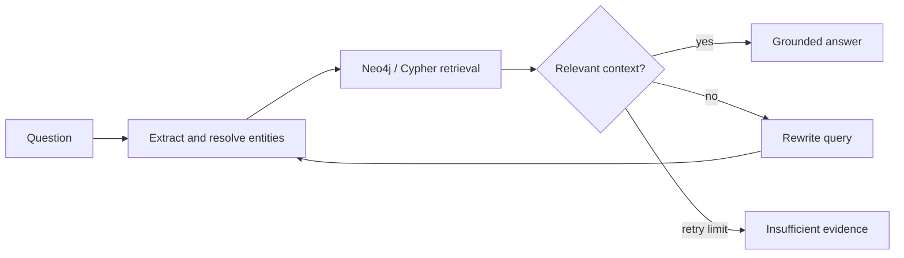

# Foundation Model and GenAI Experiments

Experiments in parameter-efficient LLM adaptation, multimodal retrieval, and graph-based retrieval-augmented generation.

The repository contains three independent workflows:

1. QLoRA fine-tuning of `Qwen/Qwen2.5-1.5B-Instruct` on medical instruction data.
2. CLIP-based text-to-image and multimodal retrieval with ChromaDB.
3. Neo4j GraphRAG with entity resolution, multi-hop Cypher retrieval, relevance grading, query rewriting, and grounded generation.

Medical content in this repository is used for engineering experiments only. It is not a clinical decision-support system.

## Repository structure

```text
foundation-model-genai-experiments/
├── experiments/
│   ├── qlora_finetuning/
│   │   ├── qlora_medical_finetuning.ipynb
│   │   └── src/
│   ├── multimodal_retrieval/
│   │   ├── clip_multimodal_retrieval.ipynb
│   │   ├── config.yaml
│   │   └── src/
│   └── graphrag/
│       ├── notebooks/
│       │   ├── knowledge_graph_etl.ipynb
│       │   └── corrective_graphrag.ipynb
│       ├── config/
│       ├── data/
│       ├── scripts/
│       └── src/graphrag/
├── requirements/
├── tests/
├── Makefile
└── pyproject.toml
```

## QLoRA fine-tuning

The fine-tuning workflow uses 4-bit NF4 quantization with LoRA adapters and supervised fine-tuning. It includes data normalization, sequence-length diagnostics, response-only loss masking, baseline and adapted-model inference, ROUGE-L evaluation, optional LLM-based judging, safety probes, adapter packaging, and optional merged-weight export.

```bash
python -m pip install -r requirements/finetuning.txt
cd experiments/qlora_finetuning
cp ../../.env.example .env
jupyter lab qlora_medical_finetuning.ipynb
```

Configured training parameters:

| Setting | Value |
|---|---|
| Base model | `Qwen/Qwen2.5-1.5B-Instruct` |
| Quantization | 4-bit NF4 with double quantization |
| LoRA rank / alpha | 16 / 32 |
| Target modules | q/k/v/o projections and gate/up/down projections |
| Trainable parameters | 18,464,768 |
| Total parameters | 1,562,179,072 |
| Maximum sequence length | 512 |
| Maximum training steps | 250 |

CUDA is required for the pinned 4-bit training path. Publishing and merged/GGUF export are opt-in.

## Multimodal retrieval

The multimodal workflow creates separate text and image indexes, supports text-only and text-to-image retrieval, and combines result sets using weighted score fusion.

```bash
python -m pip install -r requirements/multimodal.txt
cd experiments/multimodal_retrieval
cp ../../.env.example .env
jupyter lab clip_multimodal_retrieval.ipynb
```

The workflow expects `data/dermamnist_128.npz`, downloaded separately from the official MedMNIST/Zenodo distribution. Dataset files are not committed to the repository.

Collection names include embedding-model identity, reruns prune stale IDs, and image IDs preserve the source dataset indices. Retrieval handles empty results and invalid search parameters explicitly.

## Neo4j GraphRAG

The graph workflow models drugs, conditions, side effects, contraindications, classes, and drug interactions.

```text
(:Drug)-[:INTERACTS_WITH]->(:Drug)
(:Drug)-[:TREATS]->(:Condition)
(:Drug)-[:CAUSES_SIDE_EFFECT]->(:SideEffect)
(:Drug)-[:CONTRAINDICATED_FOR]->(:Condition)
(:Drug)-[:BELONGS_TO_CLASS]->(:DrugClass)
```



Setup:

```bash
python -m pip install -r requirements/graphrag.txt
cd experiments/graphrag
cp ../../.env.example .env
make init-and-seed
jupyter lab notebooks/
```

The bundled graph data is synthetic and intended for retrieval engineering. It is not an authoritative pharmacology source.

## Configuration

Copy `.env.example` into the experiment directory being run. Credentials are read from environment variables for Hugging Face, Gemini/Google, OpenRouter/OpenAI, and Neo4j.

Generated model weights, adapters, Chroma databases, downloaded datasets, and local Neo4j state are excluded from version control.

## Tests

```bash
python -m pip install -r requirements/test.txt
python -m pytest -q
```

Live Neo4j checks require an explicitly disposable database:

```bash
GRAPHRAG_TEST_URI=bolt://localhost:7687 \
GRAPHRAG_TEST_ALLOW_CLEAR=1 \
python -m pytest -q tests/test_live_neo4j.py
```

GPU training, paid provider calls, and live external services depend on the target environment and credentials.

## Experiment notes

- QLoRA evaluation compares the frozen base model and adapter on the same held-out prompts.
- Multimodal indexes use consistent cosine distance and normalized CLIP image vectors.
- Graph retrieval resolves exact aliases before fuzzy and semantic matching.
- Corrective GraphRAG replaces stale context on each retry and returns an explicit insufficient-evidence response after the retry limit.
- External model and dataset licenses remain governed by their respective providers.
