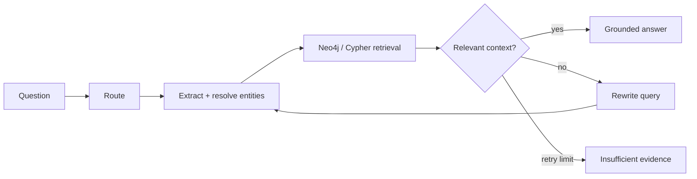

# Foundation Model Fine-Tuning and Advanced GenAI Experiments

1. **Parameter-efficient fine-tuning** of `Qwen/Qwen2.5-1.5B-Instruct` using 4-bit QLoRA on medical instruction data.
2. **CLIP-based multimodal retrieval** for text-to-image search, text retrieval, score fusion, and retrieval-augmented generation over image metadata.
3. **Neo4j GraphRAG** for multi-hop reasoning over drugs, conditions, side effects, classes, contraindications, and drug interactions.

> The medical examples in this repository are research and engineering experiments only. They are not clinical tools and must not be used for diagnosis, prescribing, treatment decisions, or patient care.

## Highlights

- Fine-tuned Qwen2.5-1.5B-Instruct with **4-bit NF4 quantization + LoRA**, training **18,464,768 of 1,562,179,072 parameters (1.182%)**.
- Used Hugging Face Transformers, PEFT, TRL, bitsandbytes, and supervised fine-tuning on a sampled medical instruction dataset.
- Evaluated the adapted model with **ROUGE-L** and an **LLM-as-a-Judge** workflow, then ran targeted safety red-team prompts and investigated response-quality, decoding, and unsafe-output failure modes.
- Built **CLIP text-to-image retrieval** with ChromaDB-backed text and image indexes plus weighted score fusion.
- Built a **Neo4j/Cypher knowledge graph** and a LangGraph Corrective RAG workflow with entity resolution, multi-hop retrieval, relevance grading, query rewriting, and grounded answer generation.

## Repository layout

```text
foundation-model-genai-experiments/
├── experiments/
│   ├── qlora_finetuning/
│   │   └── qlora_medical_finetuning.ipynb
│   ├── multimodal_retrieval/
│   │   ├── clip_multimodal_retrieval.ipynb
│   │   ├── config.yaml
│   │   └── src/services.py
│   └── graphrag/
│       ├── config/
│       ├── data/raw/drug_interactions.json
│       ├── notebooks/
│       ├── scripts/
│       └── src/graphrag/
├── requirements/
├── .env.example
└── Makefile
```

## 1. QLoRA fine-tuning

The fine-tuning experiment adapts `Qwen/Qwen2.5-1.5B-Instruct` with a 4-bit QLoRA configuration. The notebook covers dataset mapping, token-length diagnostics, baseline inference, adapter training, post-tuning inference, evaluation, safety testing, adapter packaging, and optional GGUF export.

```bash
pip install -r requirements/finetuning.txt
cd experiments/qlora_finetuning
cp ../../.env.example .env
jupyter lab qlora_medical_finetuning.ipynb
```

The default experiment loads up to 500 examples from `lavita/AlpaCare-MedInstruct-52k`. Blank and duplicate examples are removed, and prompt groups are split approximately 90/10 so the same question cannot leak across train and validation sets. CUDA is required for the pinned 4-bit path. Training masks prompt tokens and filters examples whose responses would be entirely truncated. Evaluation compares the frozen base model and adapter on the same held-out prompts and saves `outputs/evaluation.json`. Publishing and merged/GGUF exports are disabled by default.

## 2. Multimodal retrieval with CLIP

The multimodal experiment encodes dermatology images with CLIP, creates a text index and an image index, supports text-only and text-to-image retrieval, and combines both rankings with weighted fusion.

```bash
pip install -r requirements/multimodal.txt
cd experiments/multimodal_retrieval
cp ../../.env.example .env
jupyter lab clip_multimodal_retrieval.ipynb
```

The notebook expects `data/dermamnist_128.npz`. Download DermaMNIST from its official MedMNIST/Zenodo distribution and place the file there before running the image indexing cells. Dataset files are intentionally not bundled. Item IDs use the original training-image indices. Both indexes upsert current items and prune stale IDs, and separate collection names prevent mixing different embedding models. Cosine distance and normalized CLIP vectors are used consistently. Empty results and invalid search parameters are handled explicitly.

## 3. Neo4j GraphRAG

The GraphRAG experiment models a drug-interaction domain using four primary node types and five relationship types:

```text
(:Drug)-[:INTERACTS_WITH]->(:Drug)
(:Drug)-[:TREATS]->(:Condition)
(:Drug)-[:CAUSES_SIDE_EFFECT]->(:SideEffect)
(:Drug)-[:CONTRAINDICATED_FOR]->(:Condition)
(:Drug)-[:BELONGS_TO_CLASS]->(:DrugClass)
```

The retrieval workflow resolves entities from natural-language questions, traverses one-hop and multi-hop relationships, grades retrieved context, rewrites weak queries, and generates an answer grounded in graph context.



Setup:

```bash
pip install -r requirements/graphrag.txt
cd experiments/graphrag
cp ../../.env.example .env
make init-and-seed
jupyter lab notebooks/
```

## Configuration and secrets

Copy `.env.example` to the experiment directory you are running. Never commit real credentials.

```bash
cp .env.example .env
```

The repository is configured to read secrets from environment variables, including Hugging Face, Gemini/Google, OpenRouter/OpenAI, and Neo4j credentials.

## Reproducing the recorded experiment

The original recorded fine-tuning run used:

| Setting | Value |
|---|---|
| Base model | `Qwen/Qwen2.5-1.5B-Instruct` |
| Quantization | 4-bit NF4, double quantization |
| LoRA rank / alpha | 16 / 32 |
| Target modules | q/k/v/o projections + gate/up/down projections |
| Trainable parameters | 18,464,768 |
| Total parameters | 1,562,179,072 |
| Trainable share | 1.182% |
| Dataset sample | 500 examples |
| Train / validation | 450 / 50 |
| Maximum sequence length | 512 |
| Maximum training steps | 250 |

